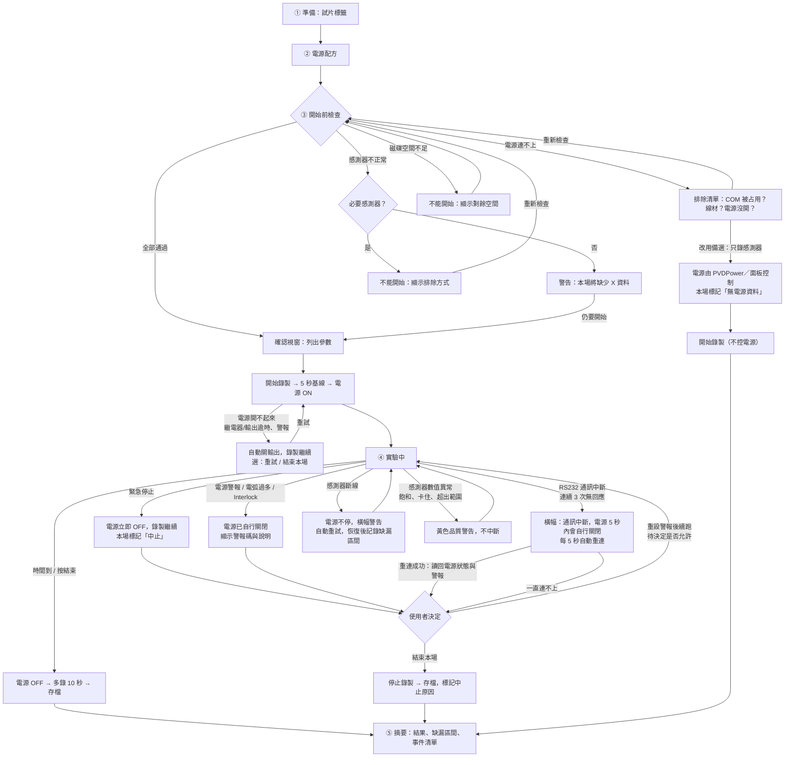

# 實驗流程 UX 設計：電源控制與感測器錄製整合（草案，2026-10-29，待審）

## 目標
- 一個頁面完成整場實驗：登記試片、設定電源、檢查、開始、結束。
- **電源開始輸出的那一刻，感測器一定已經在錄**，不再需要另外記得開系統。
- 不熟系統的人照畫面順序操作也不會出錯；出事時一個按鈕就能停。

## 現況（要改的地方）
| 現在 | 問題 |
|---|---|
| 學長在 PVDPower 開電源，另一個人（或同一人）在網頁按「輸入實驗標籤」→「開始監測」 | 兩邊各自開始、各自結束：忘了開、開晚了，或兩邊的時間對不上 |
| 電源面板和實驗錄製互相獨立（面板目前隱藏） | 錄製資料裡沒有「這場用什麼電源設定」 |
| 標籤只有金屬、試片尺寸、電解液、添加物 | 沒有試片編號、操作者，事後很難對應 SEM 結果 |

## 流程總覽
```
① 準備 ──► ② 電源配方 ──► ③ 開始前檢查 ──► ④ 實驗中 ──► ⑤ 結束與摘要
 試片標籤      模式/U/I/P/時間     感測器+電源+現場確認    自動錄製+輸出      存檔、備註、再做一次
```
畫面左側固定顯示這五步，目前在哪一步、哪一步已完成都看得到。上一步沒完成，下一步不能按；已完成的步驟可以點回去改（實驗中除外）。

---

## ① 準備：試片與實驗標籤
沿用現有的「實驗標籤」欄位，改成頁面內的表單（不再是彈出視窗），並新增：

| 欄位 | 必填 | 說明 |
|---|---|---|
| 試片編號 | ✔ | 例：AZ31-1029-03。事後對 SEM 結果靠它 |
| 操作者 | ✔ | 記住上次填的，下次自動帶入 |
| 金屬種類、試片形狀與尺寸、面積、電解液 | ✔ | 現有欄位。**面積用來算電流密度和電荷密度**，所以必填 |
| 添加物、備註 | | 現有欄位＋自由備註 |

- 按「沿用上一場」可以把上一場的標籤全部帶入，只改試片編號。

## ② 電源配方
| 欄位 | 說明 |
|---|---|
| 配方 | 下拉選單選已存的配方（例：「AZ31 標準 BiPulse」），或「自訂」 |
| 脈衝模式 | DC-B、BiPulse…；寫入電源（只能在輸出關閉時寫） |
| 頻率、佔空比 | 只有脈衝或雙極模式才顯示 |
| 電壓上限 U、電流上限 I、功率上限 P | 旁邊顯示換算的**電流密度**（I ÷ 面積），學長習慣講 A/dm² 的話就用那個單位 |
| 實驗時間 | 到時間自動結束；也可以選「手動結束」 |
| 另存為配方 | 存起來下次直接選 |

- 輸入超過額定值（1000 V／25 A／10 kW）或配方允許範圍時，欄位直接標紅，不能進下一步。
- 配方和電源目前實際的參數不同時，標出「開始時會寫入電源：頻率 1000 → 500 Hz」，讓人知道會改到機台設定。

## ③ 開始前檢查
一張清單，全部打勾才能按「開始實驗」。

**系統自動檢查**（即時更新）
- 電源：已連線、RS232 控制、Ready、無警報、Interlock 正常
- 感測器：溫度、音訊、測距、光譜儀各自的狀態
- 配方已寫入電源，讀回確認一致

**現場人工確認**（要逐項勾）
- 試片已接在正確的極（工件接 ___ 輸出）
- 電解液液面、冷卻水已開
- 槽蓋或防護已就位、人員已離開槽邊

**哪些不過還能開始？**（待決定，見最後的「要你決定的事」）
- 電源不正常：**一律不能開始**。
- 某個感測器不正常：跳出警告，寫明「這場將沒有 ___ 資料」，要再按一次才能開始；摘要和存檔裡標記缺少的感測器。

## ④ 實驗中
按「開始實驗」後先跳**確認視窗**，列出試片編號、模式、U/I/P、時間，按「確認輸出高壓」才執行。

**系統自動的順序**（使用者不需要操作）
```
開始錄製感測器 → 錄 5 秒基線（電源關閉狀態）→ 主繼電器 → 等待就緒 → 電源輸出 ON → 計時開始
```
感測器一定比電源先開始，所以資料裡有「通電前」的基線。

**畫面**
- 最上面一條大狀態列：`輸出中 · 03:12 / 10:00 · 412 V · 5.0 A · 定電流`
- 下面是所有即時圖表（電壓、電流、溫度、光譜、聲音、距離），同一條時間軸，標出「電源 ON」的時間點。
- 右上角固定一顆紅色「**緊急停止**」，任何時候都在同一個位置。
- 「結束實驗」按鈕（一般結束，會先確認）。
- 實驗中**鎖住**標籤和配方，不能改。中途要不要允許改 U/I/P 是待決事項；若允許，每次修改都記成事件。

**事件紀錄**：電源 ON/OFF、警報、電弧率異常、感測器斷線、使用者操作，都附時間戳存進同一場實驗的檔案。

## ⑤ 結束
**一般結束**（時間到或按「結束實驗」）
```
電源輸出 OFF → 主繼電器 OFF → 繼續錄 10 秒（冷卻、餘波）→ 停止錄製 → 存檔
```
**緊急停止**：電源立刻 OFF；感測器**繼續錄**，讓人看得到停止後發生什麼，由使用者按「停止錄製」結束；這場標記為「中止」。

**電源跳警報**：電源自己關了輸出，網頁顯示警報內容；錄製繼續，詢問「結束這場」還是「重設警報後繼續」（後者也記成事件）。

**摘要頁**
| 項目 | 內容 |
|---|---|
| 結果 | 完成／中止／警報 |
| 通電時間、最高電壓、最終電壓與電流 | |
| 通過電荷密度、比能量 | 用平均電流和面積算（待確認脈衝模式下電源平均值的定義） |
| 電弧次數 | |
| 缺少的感測器 | 若有 |
| 檔案位置 | 這場的資料夾 |
| 觀察備註 | 自由填寫：火花顏色、聲音、異常現象（實驗中觀察的東西最容易忘） |

按鈕：「**同樣配方再做一場**」（帶入標籤與配方，只需改試片編號；方便做重複實驗）、「新實驗」。

---

## 錯誤與備選流程

### 原則
1. **電源安全優先，資料其次。** 電源相關的異常一律先讓輸出關閉；感測器異常**不停電源**（停了這片試片就作廢，而感測器資料缺一段還能補救或標記）。
2. **不靠軟體也會停。** RS232 線斷、程式當掉、電腦當機時，網頁送不出關機命令；這時靠電源本身的保護：超過 4–5 秒沒收到命令，電源自己關輸出（警報 61613 ActSourceFail）。
3. **錄製不中斷。** 出任何錯，感測器錄製都繼續，直到使用者結束；事後才看得到「出錯前後發生什麼」。
4. **每個錯誤都有：偵測方式、系統自動動作、畫面顯示、使用者可選的下一步、記錄的內容。**
5. **事後一定能分辨**：這場是「完成」「中止」還是「有缺漏」，缺了哪個感測器、從幾秒到幾秒。

### 流程圖（含錯誤分支）


### 開始前（③ 檢查）的錯誤
| 錯誤 | 怎麼偵測 | 畫面與排除提示 | 備選 |
|---|---|---|---|
| 電源打不開 COM8 | 開埠失敗「拒絕存取」 | 「COM8 被其他程式占用，請關閉 PVDPower 或 LabVIEW 紀錄程式」 | 關掉後「重新檢查」 |
| 電源不回應 | 開埠成功但識別命令逾時 | 依序檢查：電源主開關、RS232 線兩端、COM 編號是否變了（顯示目前所有 COM） | 「只錄感測器」模式 |
| 電源不是 RS232 控制 | 狀態位元 RS control = 0 | 「電源控制來源不是 RS232，網頁無法控制」 | 同上 |
| 電源有警報、Interlock 觸發 | 狀態位元 | 顯示警報碼與中文說明；Interlock 提示檢查安全迴路 | 重設警報（Interlock 解除後才有效） |
| 配方寫入後讀回不一致 | 寫入後讀回比對 | 列出哪個參數不一致 | 不能開始；重寫一次 |
| 感測器找不到或讀不到 | 現有預檢（開埠、試讀） | 每個感測器各自的原因與排除方式 | 非必要的：警告後可開始；必要的：不能開始 |
| 磁碟剩餘空間不足 | 開始前檢查（門檻待定，例如 5 GB） | 顯示剩餘空間 | 不能開始 |

### 實驗中的錯誤
| 錯誤 | 偵測（約多久發現） | 系統自動動作 | 畫面 | 使用者選項 |
|---|---|---|---|---|
| **RS232 線斷、轉接頭鬆脫** | 連續 3 次無回應（約 1.5 秒） | 停止送開機命令；每 5 秒自動重連；**電源 4–5 秒內自行關輸出** | 紅色橫幅：「與電源通訊中斷，電源會在 5 秒內自行關閉」，倒數 | 結束本場；重連成功後畫面顯示電源實際狀態（應為 OFF＋警報 61613），再決定 |
| 電源警報（電弧過多、過溫、冷卻水…） | 狀態位元＋讀警報碼（≤0.5 秒） | 電源自己已關；網頁同步把開機旗標清掉，避免重設後自動再開 | 紅色橫幅：警報碼＋中文說明＋建議檢查項目 | 結束本場；或重設警報後續跑（待決定） |
| Interlock 觸發 | 狀態位元 | 同上 | 「安全迴路被打開（門、蓋子、急停？）」 | 同上 |
| 緊急停止 | 使用者按下 | 立即送 OFF；之後再補送一次確認 | 「已緊急停止」 | 停止錄製 |
| 感測器斷線（USB 鬆脫、設備當掉） | 連續 10 次失敗（依感測器 1–10 秒） | 電源不停；worker 持續重試，插回後自動恢復（現有行為） | 該感測器卡片變紅＋橫幅「溫度已中斷 00:12」；恢復後變回綠並記下缺漏秒數 | 繼續；或結束本場 |
| 感測器數值異常但有訊號 | 規則檢查：光譜峰值 ≥ 65535（飽和）、數值長時間完全不變、超出物理範圍、音訊全靜音或削波 | 不中斷，記成品質事件 | 黃色提示 | 繼續（事後看事件清單） |
| 瀏覽器關掉、網路斷 | — | 實驗照常跑完（控制在伺服器端） | 重新開頁面回到「實驗中」 | — |
| 伺服器程式當掉 | — | 電源 4–5 秒後自行關閉；已寫入的資料都在（每筆 flush） | 重啟後偵測到「上次實驗沒有正常結束」，提示並把那場標記為「中斷」 | 檢查資料後再開新實驗 |
| 錄製中磁碟快滿 | 每分鐘檢查 | 剩 1 GB 時警告；剩 200 MB 時自動走正常結束流程（電源先關） | 橫幅 | — |
| 電腦斷電、當機 | — | 同「伺服器當掉」：電源自行關閉 | 重開後同上 | — |

> 電源保護（4–5 秒自行關閉）是電源本身的功能，第一次實機測試時要**實際拔線驗證一次**，確認真的會關。
> 現場另外要知道機台上的實體急停或主電源開關位置，網頁和線都失效時用。

### 摘要頁的錯誤呈現
- 結果標記：完成／完成但有缺漏／中止（使用者）／中止（電源警報）／中止（通訊中斷）／中斷（程式異常）。
- **缺漏區間表**：哪個感測器、從第幾秒到第幾秒、原因。
- 事件清單（可篩選：全部／警告以上）。

## Log 設計（事後溯源用）

### 要能回答的問題
- 這片試片當時用什麼配方？電源實際參數是什麼？哪一版程式？
- 這段資料是真的量到、還是失敗留空、還是模擬的？
- 出問題的那一刻，每個感測器和電源各在什麼狀態？誰按了什麼？

### 五個層級
| 檔案 | 位置 | 格式 | 內容 | 現況 |
|---|---|---|---|---|
| 伺服器 log | `logs/server_YYYYMMDD.log` | 文字，每行 flush | 啟動、關閉、所有事件、例外 traceback | **已有** |
| 實驗 log | `EXP_<id>/experiment_<id>.log` | 文字 | 這場實驗期間的所有 log，給人讀 | **已有** |
| **事件檔** | `EXP_<id>/events_<id>.jsonl` | 一行一個 JSON | 每個事件的結構化紀錄，給程式查 | 新增 |
| **狀態時間線** | `EXP_<id>/status_<id>.csv` | CSV，每秒一列 | 每秒所有元件的狀態快照 | 新增 |
| 實驗清單（manifest） | `EXP_<id>/experiment_<id>.json` | JSON | 標籤、配方、環境、結果、缺漏區間 | 已有（要擴充） |

另外：每個感測器的資料 CSV 每一列都有時間戳和狀態欄（失敗列留空並寫原因，現有光譜儀已是這樣），**所有感測器都要一致**。

### 事件檔欄位（events_<id>.jsonl）
```json
{"t": "2026-10-29T14:31:05.123+08:00", "elapsed_s": 192.40, "seq": 57,
 "level": "error", "source": "psu", "code": "PSU_COMM_LOST",
 "message": "連續 3 次沒有收到電源回應",
 "phase": "running", "actor": "system",
 "context": {"fail_count": 3, "last_ok_age_s": 1.6, "u_act": 412.3, "i_act": 5.01, "port": "COM8"}}
```
- `elapsed_s`：相對於本場開始，和所有資料 CSV 用同一個時鐘，可直接對齊。
- `seq`：流水號，確認沒有漏行。
- `actor`：`system`，或使用者操作時的來源（本機／IP）。
- `code`：固定的錯誤代碼，方便跨實驗統計（例：這個月 PSU_COMM_LOST 發生幾次）。

**一定要記的事件**：每個階段切換、每個使用者操作（含設定值）、電源 ON/OFF 與原因、警報（含電源回報的原文）、感測器斷線／恢復（含持續秒數）、品質警告、配方寫入與讀回、檔案開啟／關閉與筆數。

### 錯誤代碼（初版）
| 代碼 | 意思 |
|---|---|
| `PSU_PORT_BUSY` / `PSU_NO_REPLY` / `PSU_NOT_RS_CONTROL` | 開始前電源連線問題 |
| `PSU_COMM_LOST` / `PSU_COMM_RESTORED` | 實驗中通訊中斷／恢復 |
| `PSU_ALARM` / `PSU_INTERLOCK` / `PSU_START_TIMEOUT` | 電源警報、安全迴路、開機逾時 |
| `PSU_PARAM_MISMATCH` | 參數寫入後讀回不一致 |
| `USER_ESTOP` / `USER_STOP` / `USER_SETPOINT` | 使用者操作 |
| `SENSOR_LOST` / `SENSOR_RESTORED` / `SENSOR_MISSING_AT_START` | 感測器斷線、恢復、開始時就缺 |
| `QUALITY_SATURATED` / `QUALITY_STUCK` / `QUALITY_OUT_OF_RANGE` | 數值品質警告 |
| `DISK_LOW` / `RUN_RECOVERED_UNCLEAN` | 磁碟空間、上次沒有正常結束 |

### 狀態時間線欄位（status_<id>.csv，每秒一列）
`elapsed_s, phase, psu_link(ok/lost), psu_power, psu_alarm_code, psu_fail_count, temp_state, temp_age_s, audio_state, audio_age_s, distance_state, distance_age_s, spec_state, spec_age_s, disk_free_gb`
- `*_age_s`：距離該感測器最後一筆成功資料幾秒。事後畫成一張圖，就能一眼看出每個元件什麼時候是活的。

### manifest 要補的內容
- 程式版本（git commit）、模擬模式與否、電腦名稱
- 各感測器的 COM port、設備識別（電源識別字串、光譜儀序號）
- 電源參數：開始前讀回的完整參數表、結束後再讀一次
- 結果標記、中止原因、缺漏區間、事件數（依等級）

### 保存規則
- Log 和資料**永遠不自動刪除**（實驗室電腦也有禁止刪除的規則）。
- 伺服器 log 每天一個檔。
- 實驗資料夾在實驗結束後由使用者決定何時回傳實驗室機台（現有流程）。

### 溯源範例
「第 3 片膜特別薄」：
1. 打開 `EXP_<id>/experiment_<id>.json`：確認配方、電源參數、結果是「完成但有缺漏」。
2. 看 `events_<id>.jsonl`：第 192 秒 `PSU_COMM_LOST`，第 197 秒電源自行關閉。
3. 看 `status_<id>.csv`：第 192–260 秒 psu_link = lost，實際通電時間比設定少 68 秒，於是知道膜薄的原因是通電中斷。

## 其他情境
| 情境 | 系統行為 |
|---|---|
| 其他電腦開這個網頁 | 只能看，所有控制按鈕停用；緊急停止例外，任何人都能按 |
| 模擬模式 | 整個頁面頂端顯示「模擬模式」，摘要、manifest、事件檔都標記 |

## 保留「手動模式」
接電阻做實機測試、維修時，需要不錄製、單獨開關電源。現有的電源面板收到「手動模式」頁籤裡，預設不顯示，進入時提示「這個模式不會錄製資料」。

## 要你決定的事
1. 感測器不正常時：**警告後可以開始**（建議），還是一律不能開始？哪些感測器是必要的？
2. 實驗中能不能改 U/I/P？（建議：先不允許，等學長說有需要再開）
3. 基線和結束後多錄的秒數：建議通電前 5 秒、結束後 10 秒。
4. 停止條件：只有時間（建議先這樣），還是要加「電壓達到 ___ V 後再跑 ___ 秒」這類條件？
5. 要不要保留「只錄感測器、不控電源」的舊流程（例如學長堅持用 PVDPower 的時候）？建議保留成選項。
6. 現場人工確認的項目，要請學長補充或刪減。
7. 電源中途關閉（警報、通訊中斷）後，允許「重設後續跑同一場」嗎？建議**不允許**：中斷過的試片條件已經不同，結束後在新的一場標記「接續 EXP_xxx」比較乾淨。
8. 磁碟空間門檻：開始前至少 5 GB、錄製中剩 1 GB 警告、剩 200 MB 自動結束，可以嗎？
9. 品質警告的規則（飽和、卡住、超出範圍）要先做哪幾種？建議先做光譜飽和和「數值完全不變」兩種。
